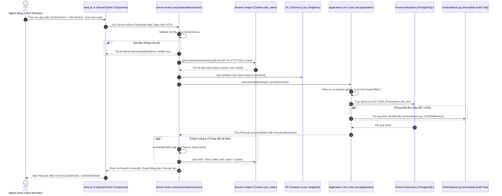

# TỔNG HỢP MA TRẬN TƯƠNG TÁC GIỮA NEXT.JS APP & SERVER ACTIONS
## Hệ Thống Quản Lý Delivery Hub (IT3180)
**Tài liệu tham chiếu:** `docs/system/actions_and_app_interactions.md`  
**Kiến trúc:** Clean Architecture Monolith + Next.js App Router (Server Actions)

---

## 1. TỔNG QUAN KIẾN TRÚC TƯƠNG TÁC (APP <-> ACTIONS <-> DOMAIN)



---

## 2. QUY CHUẨN GIAO THỨC PHẢN HỒI (RESULT PATTERN DÙNG CHUNG)

Mọi Server Action trả về thống nhất theo kiểu `Result<TData, string>`:
```typescript
export type Result<TData, TError = string> =
  | { success: true; data: TData }
  | { success: false; error: TError; fieldErrors?: Record<string, string[]> };
```

---

## 3. MA TRẬN CHI TIẾT 23 USE CASES: TƯƠNG TÁC MÀN HÌNH VÀ SERVER ACTIONS

---

### PHÂN HỆ 1: XÁC THỰC & HỒ SƠ CÁ NHÂN (AUTH & PROFILE)

#### 1. Đăng nhập hệ thống (UC01)
* **Tuyến đường App Router:** `/login`
* **Trigger UI:** Form submit `username`/`email` và `password`.
* **Server Action:** `loginAction(input: LoginInputDTO | FormData)` trong `auth.actions.ts`.
* **Phân quyền & Session:** Công khai (chưa đăng nhập).
* **Use Case thực thi:** `LoginUserUseCase` (`src/application/use-cases/auth/login.use-case.ts`).
* **Hạ tầng tác động:**
  * `PrismaUserRepository.findByUsernameOrEmail`.
  * `BcryptPasswordHasherService.compare`.
  * `JwtAuthTokenService.generateToken`.
* **Side-effects:**
  * Ghi HTTP-Only Cookie: `auth_token` (`httpOnly: true`, `secure: prod`, `sameSite: 'lax'`).
  * Gọi `revalidatePath('/', 'layout')`.
  * Client redirect về Dashboard phù hợp vai trò:
    * `ADMIN` -> `/admin/dashboard`
    * `HUB_MANAGER` / `HUB_STAFF` -> `/hub/dashboard`
    * `SHIPPER` -> `/shipper/deliveries`
* **Xử lý lỗi:** Sai mật khẩu, tài khoản bị khóa `LOCKED`, hoặc tạm khóa sau 5 lần sai (Brute-force defense).

#### 2. Đăng xuất hệ thống
* **Tuyến đường App Router:** Nút "Đăng xuất" trên thanh Header / Sidebar mọi trang nội bộ.
* **Trigger UI:** Click button "Đăng xuất".
* **Server Action:** `logoutAction()` trong `auth.actions.ts`.
* **Phân quyền & Session:** Yêu cầu đã đăng nhập.
* **Side-effects:**
  * Xóa Cookie `auth_token` (`maxAge: 0`).
  * Gọi `revalidatePath('/', 'layout')`.
  * Client redirect về `/login`.

#### 3. Đổi mật khẩu cá nhân (UC02)
* **Tuyến đường App Router:** `/profile/change-password` hoặc Modal trong `/profile`.
* **Trigger UI:** Form submit `currentPassword`, `newPassword`, `confirmPassword`.
* **Server Action:** `changePasswordAction(input: ChangePasswordFormDTO | FormData)` trong `auth.actions.ts`.
* **Phân quyền & Session:** Bắt buộc `SecurityContext` (Fail-Closed).
* **Use Case thực thi:** `ChangePasswordUseCase`.
* **Hạ tầng tác động:**
  * `PrismaUserRepository.findById` & `updatePassword`.
  * `BcryptPasswordHasherService.hash`.
* **Side-effects:** Toast thông báo thành công; yêu cầu đăng nhập lại bằng mật khẩu mới nếu cần.

#### 4. Xem & Cập nhật hồ sơ cá nhân (UC03)
* **Tuyến đường App Router:** `/profile`
* **Trigger UI:**
  * Server Component nạp trang gọi `getCurrentUserAction()`.
  * Client form submit cập nhật `fullName`, `phone`.
* **Server Action:** `getCurrentUserAction()` và `updateProfileAction(input: UpdateProfileFormDTO | FormData)`.
* **Phân quyền & Session:** Bắt buộc `SecurityContext` (Chống IDOR: người dùng chỉ được sửa hồ sơ của chính mình).
* **Use Case thực thi:** `GetProfileUseCase` & `UpdateProfileUseCase`.
* **Hạ tầng tác động:** `PrismaUserRepository.findById` & `save`.
* **Side-effects:** `revalidatePath('/profile')`.

---

### PHÂN HỆ 2: QUẢN LÝ TÀI KHOẢN & NHÂN SỰ TRẠM (STAFF MANAGEMENT)

#### 5. Xem danh sách nhân viên trạm (UC04)
* **Tuyến đường App Router:** `/admin/staff` (Admin xem toàn quốc) hoặc `/hub/staff` (Manager xem tại trạm).
* **Trigger UI:** Nạp trang phân trang, lọc theo vai trò (`role`), trạng thái (`status`), tìm theo tên/SĐT.
* **Server Action:** `getStaffListAction(query: GetStaffListQueryDTO)` trong `staff.actions.ts`.
* **Phân quyền & Session:** `ADMIN` (xem mọi trạm) hoặc `HUB_MANAGER` (chỉ xem trạm mình phụ trách - Hub Isolation).
* **Use Case thực thi:** `GetStaffListUseCase`.
* **Hạ tầng tác động:** `PrismaUserRepository.findMany` (kèm index `@@index([hubId, role, status])`).
* **Đầu ra:** Danh sách nhân sự kèm thông tin trạm, phân trang chuẩn `page`, `pageSize`, `totalPages`.

#### 6. Tạo mới tài khoản nhân viên (UC05)
* **Tuyến đường App Router:** `/admin/staff/new` hoặc Dialog "Thêm nhân viên".
* **Trigger UI:** Submit form `username`, `fullName`, `email`, `phone`, `role`, `hubId`.
* **Server Action:** `createStaffAction(input: CreateStaffInputDTO | FormData)` trong `staff.actions.ts`.
* **Phân quyền & Session:** `ADMIN` (tạo mọi role) hoặc `HUB_MANAGER` (chỉ tạo `HUB_STAFF` và `SHIPPER` cho trạm mình).
* **Use Case thực thi:** `CreateStaffUseCase`.
* **Hạ tầng tác động:** `PrismaUserRepository.save`, `BcryptPasswordHasherService.hash` mật khẩu mặc định an toàn.
* **Side-effects:** `revalidatePath('/admin/staff')`, toast thông báo thành công.

#### 7. Cập nhật thông tin nhân sự (UC06)
* **Tuyến đường App Router:** `/admin/staff/[id]/edit` hoặc Dialog Sửa.
* **Trigger UI:** Submit form sửa tên, SĐT, điều chuyển `hubId`, đổi chức vụ `role`.
* **Server Action:** `updateStaffAction(input: UpdateStaffInputDTO | FormData)` trong `staff.actions.ts`.
* **Phân quyền & Session:** `ADMIN` hoặc `HUB_MANAGER` (theo nguyên tắc cách ly trạm).
* **Use Case thực thi:** `UpdateStaffUseCase`.
* **Hạ tầng tác động:** `PrismaUserRepository.save`.
* **Side-effects:** `revalidatePath('/admin/staff')`.

#### 8. Khóa / Mở khóa tài khoản nhân sự (UC07)
* **Tuyến đường App Router:** `/admin/staff` -> Action menu "Khóa tài khoản" / "Kích hoạt".
* **Trigger UI:** Click switch toggle hoặc button xác nhận.
* **Server Action:** `toggleStaffStatusAction(input: ToggleStaffStatusInputDTO)` trong `staff.actions.ts`.
* **Phân quyền & Session:** `ADMIN` hoặc `HUB_MANAGER`. Không được tự khóa tài khoản của chính mình.
* **Use Case thực thi:** `ToggleStaffStatusUseCase`.
* **Hạ tầng tác động:** `PrismaUserRepository.updateStatus`.
* **Side-effects:** `revalidatePath('/admin/staff')`.

#### 9. Phân công tuyến giao hàng cho Shipper (UC08)
* **Tuyến đường App Router:** `/hub/shippers/[id]/zones` hoặc Dialog "Gán tuyến".
* **Trigger UI:** Chọn tuyến đường (`zoneId`) từ danh mục và gán cho `shipperId`.
* **Server Action:** `assignShipperZoneAction(input: AssignShipperZoneInputDTO)` trong `staff.actions.ts`.
* **Phân quyền & Session:** `ADMIN` hoặc `HUB_MANAGER` quản lý trạm đó.
* **Use Case thực thi:** `AssignShipperZoneUseCase`.
* **Hạ tầng tác động:** `PrismaDeliveryZoneRepository.assignShipperToZone` (bảng `shipper_zones`).
* **Side-effects:** `revalidatePath('/hub/shippers')`.

---

### PHÂN HỆ 3: QUẢN TRỊ ĐƠN HÀNG (ORDER MANAGEMENT)

#### 10. Tiếp nhận / Tạo mới đơn hàng (UC09)
* **Tuyến đường App Router:** `/orders/create` (Trang tạo đơn tại quầy bưu cục).
* **Trigger UI:** Submit form người gửi, người nhận, địa chỉ 3 cấp (Tỉnh/Quận/Phường), kích thước (DxRxC, khối lượng), tiền COD, người trả cước.
* **Server Action:** `createOrderAction(input: CreateOrderInputDTO | FormData)` trong `order.actions.ts`.
* **Phân quyền & Session:** `ADMIN`, `HUB_MANAGER`, `HUB_STAFF`. Cấm `SHIPPER` tạo đơn.
* **Use Case thực thi:** `CreateOrderUseCase`.
* **Hạ tầng tác động (ACID Transaction):**
  1. Tự động sinh `TrackingCode` duy nhất chuẩn logistics (`TRK-YYYYMMDD-XXXXXX`).
  2. Tự động tính cước thể tích chuẩn ($DxRxC / 5000$).
  3. Insert vào bảng `orders`.
  4. Insert bản ghi khởi tạo đầu tiên vào `order_status_logs`.
* **Side-effects:** `revalidatePath('/orders')`, trả về mã vận đơn để in phiếu / tem nhãn.

#### 11. Tìm kiếm & Lọc danh sách đơn hàng (UC10)
* **Tuyến đường App Router:** `/orders`
* **Trigger UI:** Ô tìm kiếm (Mã đơn, SĐT), bộ lọc trạng thái (`currentStatus`), bộ lọc trạm (`hubId`), khoảng ngày tạo.
* **Server Action:** `getOrderListAction(query: GetOrderListQueryDTO)` trong `order.actions.ts`.
* **Phân quyền & Session:** Tự động lọc theo trạm nếu là Quản lý/Nhân viên trạm (Chống rò rỉ dữ liệu đa trạm BOLA).
* **Use Case thực thi:** `GetOrderListUseCase`.
* **Hạ tầng tác động:** `PrismaOrderRepository.findMany` (sử dụng các composite index tối ưu: `@@index([currentHubId, currentStatus])`, `@@index([receiverPhone])`, `@@index([createdAt(sort: Desc)])`).
* **Đầu ra:** Danh sách đơn hàng phân trang, tổng số đơn, tổng tiền COD.

#### 12. Xem chi tiết đơn hàng & Lịch sử kiểm vết (UC11)
* **Tuyến đường App Router:** `/orders/[trackingCode]`
* **Trigger UI:** Click vào một dòng trong danh sách đơn hoặc quét mã vận đơn.
* **Server Action:** `getOrderDetailAction(input: { idOrTrackingCode: string })` trong `order.actions.ts`.
* **Phân quyền & Session:** Nhân sự hệ thống có thẩm quyền.
* **Use Case thực thi:** `GetOrderDetailUseCase`.
* **Hạ tầng tác động:**
  * `PrismaOrderRepository.findByTrackingCode` / `findById`.
  * `PrismaOrderStatusLogRepository.findByOrderId` (sắp xếp thời gian giảm dần qua index `@@index([orderId, createdAt(sort: Desc)])`).
* **Đầu ra:** Thông tin chi tiết đơn + Toàn bộ dòng thời gian Timeline lịch sử di chuyển và trạng thái.

#### 13. Chỉnh sửa thông tin đơn hàng (UC12)
* **Tuyến đường App Router:** `/orders/[trackingCode]/edit`
* **Trigger UI:** Sửa địa chỉ nhận, SĐT người nhận, tiền COD trước khi đơn xuất kho đi phát.
* **Server Action:** `updateOrderAction(input: UpdateOrderInputDTO | FormData)` trong `order.actions.ts`.
* **Phân quyền & Session:** `ADMIN` hoặc Nhân viên trạm đang giữ đơn hàng.
* **Điều kiện bất biến (Invariant):** Chỉ được sửa khi đơn ở trạng thái `CREATED` hoặc `AT_HUB`. Cấm sửa khi đang `OUT_FOR_DELIVERY` hoặc đã hoàn tất.
* **Use Case thực thi:** `UpdateOrderUseCase`.
* **Hạ tầng tác động:** `PrismaOrderRepository.save` & ghi nhận log cập nhật.
* **Side-effects:** `revalidatePath('/orders')`.

#### 14. Hủy đơn hàng (UC13)
* **Tuyến đường App Router:** `/orders/[trackingCode]` -> Nút "Hủy đơn hàng".
* **Trigger UI:** Modal nhập lý do hủy đơn bắt buộc.
* **Server Action:** `cancelOrderAction(input: CancelOrderInputDTO)` trong `order.actions.ts`.
* **Phân quyền & Session:** `ADMIN` hoặc `HUB_MANAGER`.
* **Điều kiện bất biến:** Đơn chưa giao thành công (`DELIVERED`) hoặc chưa chuyển hoàn xong (`RETURNED`).
* **Use Case thực thi:** `CancelOrderUseCase`.
* **Hạ tầng tác động (ACID Transaction):**
  * Cập nhật `current_status = CANCELLED`.
  * Insert bản ghi hủy đơn vào `order_status_logs`.
* **Side-effects:** `revalidatePath('/orders')`.

#### 15. Nhập đơn hàng loạt từ file Excel/CSV (UC14)
* **Tuyến đường App Router:** `/orders/import`
* **Trigger UI:** Tải lên tệp danh sách đơn (hoặc paste JSON bảng dữ liệu).
* **Server Action:** `importOrdersAction(input: ImportOrdersInputDTO)` trong `order.actions.ts`.
* **Phân quyền & Session:** `ADMIN` hoặc `HUB_MANAGER`. Giới hạn tối đa 200 đơn/lần (Chống DoS/OOM).
* **Use Case thực thi:** `ImportOrdersUseCase`.
* **Hạ tầng tác động:** Transaction ACID nhập hàng loạt đơn và tự sinh mã TRK cho từng đơn.
* **Đầu ra:** Thống kê số đơn thành công, số đơn lỗi chi tiết từng dòng.

---

### PHÂN HỆ 4: ĐIỀU PHỐI & VÒNG ĐỜI VẬN CHUYỂN (SHIPMENT & DISPATCHING)

#### 16. Quét mã Inbound nhập kho trạm (UC15)
* **Tuyến đường App Router:** `/shipments/inbound` (Giao diện bắn máy quét mã vạch Barcode/QR).
* **Trigger UI:** Bắn barcode hoặc nhập mã vận đơn tại cửa kho bưu cục.
* **Server Action:** `checkInHubAction(input: CheckInHubInputDTO | FormData)` trong `shipment.actions.ts`.
* **Phân quyền & Session:** `HUB_STAFF`, `HUB_MANAGER` tại trạm tiếp nhận.
* **Use Case thực thi:** `CheckInHubUseCase`.
* **Hạ tầng tác động:**
  * Chuyển trạng thái đơn sang `AT_HUB`.
  * Ghi log trạm tiếp nhận vào `order_status_logs`.
* **Side-effects:** `revalidatePath('/shipments/inbound')`, phát âm thanh Beep thành công trên UI.

#### 17. Phân công bàn giao đơn cho Shipper đi phát (UC16)
* **Tuyến đường App Router:** `/shipments/dispatch` (Màn hình chia tuyến & gán hàng cho Shipper).
* **Trigger UI:** Chọn nhiều đơn hàng đang `AT_HUB` (theo địa bàn Phường/Xã) và chọn Shipper trực thuộc trạm -> Nhấn "Bàn giao".
* **Server Action:** `assignOrdersToShipperAction(input: AssignOrdersToShipperInputDTO)` trong `shipment.actions.ts`.
* **Phân quyền & Session:** `HUB_MANAGER`, `HUB_STAFF`. Shipper nhận hàng phải thuộc cùng trạm.
* **Use Case thực thi:** `AssignOrdersToShipperUseCase`.
* **Hạ tầng tác động (ACID Transaction):**
  * Cập nhật hàng loạt: `assigned_shipper_id = shipperId`, `current_status = OUT_FOR_DELIVERY`.
  * Sinh hàng loạt bản ghi bàn giao trong `order_status_logs`.
* **Side-effects:** In biên bản bàn giao phát hàng; cập nhật danh sách đơn của Shipper trên App mobile.

#### 18. Giao hàng thành công & Thu tiền COD (UC17, UC18)
* **Tuyến đường App Router:** `/shipper/deliveries` (Màn hình app di động của Shipper).
* **Trigger UI:** Shipper bấm "Xác nhận giao thành công" -> Chụp ảnh ký nhận POD (Proof of Delivery), nhập số tiền COD thực thu, tọa độ GPS.
* **Server Action:** `markDeliveredAction(input: MarkDeliveredInputDTO | FormData)` trong `shipment.actions.ts`.
* **Phân quyền & Session:** Bắt buộc là chính Shipper được gán đơn đó (Chống BOLA - Shipper khác không thể can thiệp).
* **Use Case thực thi:** `MarkDeliveredUseCase`.
* **Hạ tầng tác động (ACID Transaction):**
  * Cập nhật `current_status = DELIVERED`, `payment_status = PAID`.
  * Ghi `order_status_logs` kèm URL ảnh POD (`proof_image_url`) và vị trí GPS (`location_lat`, `location_lng`).
* **Side-effects:** Đơn chuyển sang trạng thái chờ đối soát nộp tiền COD.

#### 19. Báo cáo giao hàng thất bại (UC19)
* **Tuyến đường App Router:** `/shipper/deliveries` -> Nút "Giao thất bại".
* **Trigger UI:** Chọn lý do thất bại (Khách không nghe máy, Sai địa chỉ, Khách hẹn lại ngày giao, Khách từ chối nhận).
* **Server Action:** `markFailedAttemptAction(input: MarkFailedAttemptInputDTO | FormData)` trong `shipment.actions.ts`.
* **Phân quyền & Session:** Shipper phụ trách đơn.
* **Use Case thực thi:** `MarkFailedAttemptUseCase`.
* **Logic vòng đời:**
  * Tăng biến đếm `deliveryAttempts` lên 1.
  * Nếu `deliveryAttempts < 3` và khách hẹn lại -> trạng thái `FAILED_ATTEMPT` (chờ phát lại).
  * Nếu `deliveryAttempts >= 3` hoặc khách từ chối vĩnh viễn (`CUSTOMER_REJECTED`) -> tự động kích hoạt trạng thái **`RETURN_PENDING` (Chờ chuyển hoàn)**.
* **Side-effects:** Ghi log chi tiết lý do thất bại vào `order_status_logs`.

#### 20. Xử lý đơn chuyển hoàn về người gửi (UC20)
* **Tuyến đường App Router:** `/shipments/returns` (Màn hình quản lý hàng hoàn tại trạm).
* **Trigger UI:** Quản lý trạm duyệt chuyển hoàn hoặc hoàn tất trả hàng cho Shop gửi.
* **Server Action:** `processReturnOrderAction(input: ProcessReturnOrderInputDTO)` trong `shipment.actions.ts`.
* **Phân quyền & Session:** Nhân viên / Quản lý trạm.
* **Use Case thực thi:** `ProcessReturnOrderUseCase`.
* **Hạ tầng tác động:** Cập nhật trạng thái `RETURNED`, ghi log hoàn trả.
* **Side-effects:** `revalidatePath('/shipments/returns')`.

---

### PHÂN HỆ 5: ĐỐI SOÁT COD & THỐNG KÊ HIỆU SUẤT (COD & ANALYTICS)

#### 21. Thống kê hiệu suất trạm & KPI Shipper (UC21)
* **Tuyến đường App Router:** `/hub/dashboard` hoặc `/admin/analytics`
* **Trigger UI:** Xem Dashboard tổng quan: số đơn theo từng trạng thái, tỷ lệ giao thành công, bảng xếp hạng KPI shipper.
* **Server Action:** `getHubStatisticsAction(query: GetHubStatisticsQueryDTO)` trong `cod.actions.ts`.
* **Phân quyền & Session:** `ADMIN` hoặc `HUB_MANAGER`.
* **Use Case thực thi:** `GetHubStatisticsUseCase`.
* **Hạ tầng tác động:** Tối ưu hóa truy vấn Aggregation bằng index `@@index([currentHubId, currentStatus])`.
* **Đầu ra:** Dữ liệu biểu đồ trực quan (Charts ready).

#### 22. Shipper nộp tiền COD cuối ca & Quản lý duyệt đối soát (UC22)
* **Tuyến đường App Router:**
  * Shipper: `/shipper/cod-settlement` (Tạo phiên bàn giao tiền).
  * Quản lý: `/hub/cod-settlements` (Duyệt nộp tiền mặt/chuyển khoản).
* **Trigger UI:**
  * Shipper chọn danh sách các đơn đã thu COD thành công -> Bấm "Nộp tiền COD".
  * Quản lý kiểm đếm tiền mặt khớp số liệu -> Bấm "Xác nhận đã thu" (`CONFIRMED`) hoặc "Từ chối" (`REJECTED`).
* **Server Action:**
  * `createCODSettlementAction(input: CreateCODSettlementInputDTO)`
  * `reviewCODSettlementAction(input: ReviewCODSettlementInputDTO)`
* **Use Case thực thi:** `CreateCODSettlementUseCase` & `ReviewCODSettlementUseCase`.
* **Hạ tầng tác động (ACID Transaction):**
  * Tạo bản ghi `cod_settlements` và các dòng chi tiết `cod_settlement_details`.
  * Khi duyệt `CONFIRMED`: Khóa phiên đối soát, cập nhật trạng thái đã nộp.
* **Side-effects:** In biên lai nộp tiền COD; ghi nhận doanh thu trạm.

---

### PHÂN HỆ 6: TRA CỨU HÀNH TRÌNH CÔNG KHAI (PUBLIC TRACKING)

#### 23. Tra cứu công khai hành trình vận đơn (UC23)
* **Tuyến đường App Router:** `/tracking` (Trang chủ công khai cho khách hàng vãng lai).
* **Trigger UI:** Ô nhập mã vận đơn `TRK-...` (không cần đăng nhập tài khoản).
* **Server Action:** `trackOrderPublicAction(query: PublicTrackingQueryDTO | string)` trong `tracking.actions.ts`.
* **Phân quyền & Session:** Công khai hoàn toàn (Không yêu cầu cookie).
* **Use Case thực thi:** `GetPublicTrackingUseCase`.
* **Quy tắc bảo mật riêng tư:**
  * Tự động che số điện thoại người nhận: `0912345678` -> `0912***678` (chống lộ thông tin cá nhân).
  * Chỉ hiển thị tiến trình lộ trình và trạm xử lý, không để lộ doanh thu hoặc thông tin nhạy cảm nội bộ.
* **Đầu ra:** Timeline vận chuyển hiển thị công khai dạng Stepper trực quan.

---

## 4. BẢNG TỔNG HỢP KIỂM CHỨNG TÍNH TOÀN VẸN (GAP ANALYSIS)

| Hạng mục kiểm tra | Trạng thái | Ghi chú kiến trúc |
|:---|:---:|:---|
| **Độ phủ 23 Use Cases** | **23/23 (100%)** | Toàn bộ 23 ca nghiệp vụ đều có Server Action và màn hình tương ứng. |
| **Độ phủ Database Repositories** | **6/6 (100%)** | Bao phủ trọn vẹn cả 8 Prisma Models (`Hub`, `User`, `DeliveryZone`, `ShipperZone`, `Order`, `OrderStatusLog`, `CODSettlement`, `CODSettlementDetail`). |
| **Phân quyền & Fail-Closed** | **100% Đạt** | Mọi Server Action nội bộ đều yêu cầu `SecurityContext` từ HTTP-Only Cookie. |
| **Rào chắn Chống IDOR & BOLA** | **100% Đạt** | Shipper chỉ được thao tác đơn của chính mình; Quản lý chỉ được thao tác trạm của mình. |
| **Bảo vệ Tính Toàn vẹn Dữ liệu (ACID)** | **100% Đạt** | Các tác vụ chuyển trạng thái đơn, thu tiền COD, đối soát nộp tiền đều chạy trong DB Transaction. |
| **Kiểm vết Bất biến (Audit Trail)** | **100% Đạt** | Bảng `order_status_logs` không bao giờ bị Update/Delete, lưu trọn vẹn lịch sử. |
| **Không dùng Any & Tuân thủ Clean Arch** | **100% Đạt** | Presentation Action không import database trực tiếp, chỉ tương tác qua `appContainer`. |
