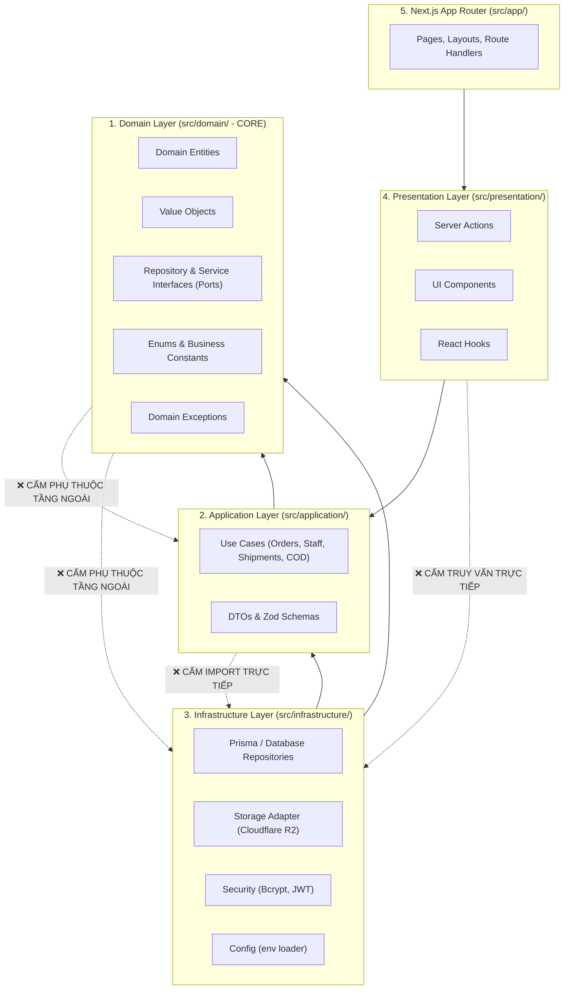
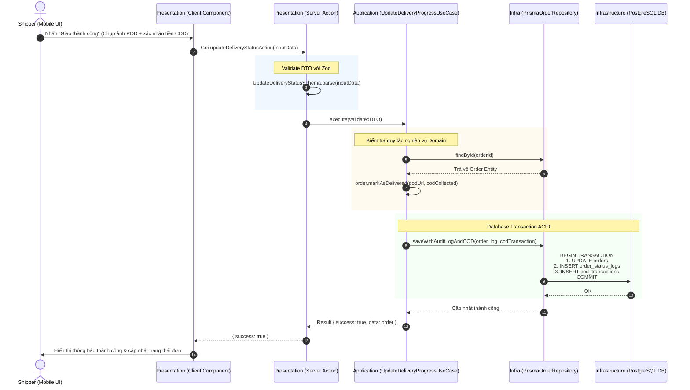

# TÀI LIỆU THIẾT KẾ KIẾN TRÚC HỆ THỐNG (SYSTEM ARCHITECTURE DESIGN)
## Hệ Thống Quản Lý Delivery Hub (IT3180)
**Môn học:** IT3180 - Công nghệ phần mềm  
**Nền tảng:** TypeScript / Next.js (App Router) + Clean Architecture Monolith  
**Phiên bản:** 1.0  
**Ngày cập nhật:** 29/10/2026  

---

## 1. Tổng quan Triết lý Kiến trúc

Hệ thống Quản lý Delivery Hub được thiết kế theo mô hình **Clean Architecture (Kiến trúc Sạch - Onion Architecture)** của Robert C. Martin (Uncle Bob), kết hợp với nền tảng **Next.js App Router (Fullstack Monolith)**.

### Mục tiêu thiết kế:
1. **Độc lập Nghiệp vụ (Independence of Business Logic):** Quy tắc giao vận, tính toán COD, và trạng thái đơn hàng không bị phụ thuộc vào giao diện (UI) hay công nghệ cơ sở dữ liệu (ORM/Prisma/PostgreSQL).
2. **Khả năng kiểm thử cao (Testability):** Toàn bộ nghiệp vụ ở tầng Domain và Application có thể viết Unit Test độc lập 100% mà không cần khởi động CSDL thật (thông qua Mock Repositories).
3. **An toàn kiểu dữ liệu từ đầu đến cuối (End-to-End Type Safety):** Khai thác tối đa sức mạnh của TypeScript từ Database Model, DTOs, Server Actions tới UI Components.
4. **Vibe Coding có kỷ luật:** Được bảo vệ bởi rào chắn tự động (`.dependency-cruiser.js`, `scripts/verify_loops.mjs` và `.agents/rules/`).

---

## 2. Nguyên tắc Phụ thuộc Một chiều (The Dependency Rule)

Trọng tâm của Clean Architecture là **luồng phụ thuộc chỉ được phép hướng vào trong**:



* **Tầng trong (Domain) là vùng bất khả xâm phạm:** Không biết bất kỳ điều gì về các tầng bên ngoài.
* **Tầng ngoài (Infrastructure, Presentation) là chi tiết (Details):** Có thể dễ dàng thay thế (ví dụ chuyển từ Prisma sang Drizzle, hoặc thay đổi giao diện) mà không làm ảnh hưởng đến lõi nghiệp vụ.

---

## 3. Cấu trúc Thư mục và Trách nhiệm Từng Tầng

```text
src/
├── domain/                                # TẦNG 1: DOENTERPRISE BUSINESS RULES (Độc lập 100%)
│   ├── entities/                          # Các thực thể nghiệp vụ cốt lõi (Order, User, Hub, ShipmentLog...)
│   ├── interface/
│   │   ├── repositories/                  # Hợp đồng lưu trữ (IOrderRepository, IUserRepository...)
│   │   └── services/                      # Hợp đồng dịch vụ ngoài (IStorageService, INotificationService...)
│   ├── value-objects/                     # Đối tượng giá trị bất biến (TrackingCode, Money, PhoneNumber...)
│   ├── constants/                         # Hằng số nghiệp vụ, Enums (ORDER_STATUS, USER_ROLE...)
│   └── exceptions/                        # Lớp ngoại lệ nghiệp vụ (OrderNotFoundException...)
│
├── application/                           # TẦNG 2: APPLICATION BUSINESS RULES
│   ├── use-cases/
│   │   ├── auth/                          # LoginUseCase, LogoutUseCase...
│   │   ├── staff/                         # CreateStaffUseCase, UpdateStaffUseCase, AssignZoneUseCase...
│   │   ├── orders/                        # CreateOrderUseCase, GetOrderDetailUseCase...
│   │   ├── shipments/                     # CheckInHubUseCase, AssignShipperUseCase, UpdateDeliveryProgressUseCase...
│   │   └── cod/                           # SettleCODUseCase, ReconcileCODUseCase...
│   ├── dtos/                              # Input/Output DTOs có Zod validation schemas
│   └── interfaces/                        # Giao diện cho Use Cases (IUseCase)
│
├── infrastructure/                        # TẦNG 3: FRAMEWORKS & TECHNICAL DRIVERS
│   ├── database/
│   │   ├── prisma/                        # Prisma schema, client singleton instance
│   │   ├── repositories/                  # Triển khai thực tế các interface (PrismaOrderRepository...)
│   │   └── mappers/                       # Mappers chuyển đổi DB Record <-> Domain Entity
│   ├── storage/                           # Adapter tải ảnh POD lên Cloudflare R2 / S3
│   ├── security/                          # BcryptHasher, JWTHelper
│   └── config/                            # Đọc và validate biến môi trường (.env)
│
├── presentation/                          # TẦNG 4: INTERFACE ADAPTERS (UI & NEXT.JS SERVER ACTIONS)
│   ├── actions/                           # Next.js Server Actions (Cầu nối giữa UI và Application Use Cases)
│   ├── components/                        # UI Components dùng chung (Table, Dialog, BarcodeScanner, Timeline...)
│   └── hooks/                             # React Client hooks (useScanner, useTracking, useDebounce...)
│
└── app/                                   # TẦNG 5: NEXT.JS APP ROUTER (ROUTES & LAYOUTS)
    ├── (auth)/login/                      # Màn hình đăng nhập
    ├── (dashboard)/                       # Không gian làm việc có phân quyền (RBAC)
    │   ├── admin/                         # Quản lý Hub, nhân sự toàn hệ thống
    │   ├── staff/                         # Quét mã Inbound, phân loại, điều phối giao
    │   ├── shipper/                       # Giao diện mobile-first cho Shipper, chụp ảnh POD
    │   └── cod/                           # Bàn giao & đối soát tiền thu hộ
    ├── tracking/                          # Tra cứu vận đơn công khai
    └── api/                               # Route Handlers cho Webhooks / Export
```

### Chi tiết vai trò từng tầng:

#### 3.1. Tầng Domain (`src/domain/`)
* **Trách nhiệm:** Lưu giữ toàn bộ quy tắc nghiệp vụ bất biến của bài toán Delivery Hub.
* **Thành phần:**
  * `entities/`: Class hoặc Interface định nghĩa đối tượng thực tế (ví dụ: `Order` có thuộc tính `trackingCode`, `currentStatus`, `codAmount`). Chứa logic nghiệp vụ nội tại (ví dụ: `order.canBeAssignedToShipper()`).
  * `interface/repositories/`: Các cổng giao tiếp (Ports) như `IOrderRepository.findById()`, `IOrderRepository.save()`.
  * `constants/`: CẤM hardcode chuỗi hoặc số ma thuật; toàn bộ trạng thái bưu kiện (`CREATED`, `AT_HUB`, `DELIVERED`...) đều nằm ở đây.
  * `exceptions/`: Định nghĩa các lỗi nghiệp vụ thuần túy, không chứa mã lỗi HTTP (400, 404).

#### 3.2. Tầng Application (`src/application/`)
* **Trách nhiệm:** Điều phối luồng dữ liệu của các ca sử dụng (Use Cases) mà hệ thống hỗ trợ.
* **Thành phần:**
  * `use-cases/`: Mỗi file đảm nhiệm 1 ca sử dụng duy nhất (Single Responsibility Principle) như `CreateOrderUseCase`, `AssignShipperUseCase`.
  * `dtos/`: Định nghĩa định dạng dữ liệu đầu vào và đầu ra, kết hợp thư viện `zod` để validate dữ liệu trước khi xử lý.
* **Đặc điểm:** Tầng này chỉ giao tiếp với CSDL thông qua interface của Domain (`IOrderRepository`), hoàn toàn không biết CSDL đằng sau là PostgreSQL hay MySQL.

#### 3.3. Tầng Infrastructure (`src/infrastructure/`)
* **Trách nhiệm:** Cung cấp triển khai kỹ thuật cụ thể (Adapters) cho các Interface mà Domain yêu cầu.
* **Thành phần:**
  * `database/repositories/`: Ví dụ `PrismaOrderRepository` implements `IOrderRepository`. Sử dụng Prisma Client để truy vấn CSDL.
  * `database/mappers/`: Chuyển đổi dữ liệu thô từ bảng Prisma sang Domain Entity chuẩn và ngược lại. Điều này ngăn việc các trường CSDL rò rỉ vào tầng Domain.
  * `storage/`: Triển khai upload ảnh bằng chứng giao hàng (POD) lên Cloudflare R2 hoặc S3.
  * `config/`: Nạp `.env` an toàn bằng Zod schema, đảm bảo nếu thiếu biến môi trường, hệ thống báo lỗi ngay lúc khởi động.

#### 3.4. Tầng Presentation (`src/presentation/`)
* **Trách nhiệm:** Chuyển đổi dữ liệu giữa định dạng thân thiện với giao diện và định dạng mà Application cần.
* **Thành phần:**
  * `actions/`: Next.js **Server Actions** (`'use server'`). Nhận request từ form/nút bấm trên giao diện, validate DTO, gọi Use Case và trả về Result Pattern `{ success: true, data }` hoặc `{ success: false, error }`.
  * `components/`: UI components có thể tái sử dụng (Bảng danh sách đơn, thanh tiến trình Timeline, camera quét mã vạch).
  * `hooks/`: Custom React hooks cho giao diện tương tác.

#### 3.5. Tầng App Router (`src/app/`)
* **Trách nhiệm:** Định tuyến (Routing), phân nhóm quyền (Route Groups), và render giao diện người dùng.
* **Thành phần:**
  * `(auth)`: Đăng nhập/Đăng xuất.
  * `(dashboard)`: Bố cục quản trị nội bộ phân quyền theo vai trò (`admin`, `staff`, `shipper`, `cod`).
  * `tracking`: Trang công khai tra cứu hành trình vận đơn.
  * `api`: Các Route Handlers REST endpoints phục vụ tích hợp webhook hoặc xuất báo cáo.

---

## 4. Luồng Xử lý Dữ liệu Thực tế (Data Flow Example)

Ví dụ luồng nghiệp vụ: **Shipper cập nhật đơn hàng thành công (kèm ảnh POD và xác nhận thu COD)**.



---

## 5. Hệ thống Rào chắn & Đảm bảo Kỷ luật Kiến trúc (Guardrails)

Để ngăn chặn việc "vibe coding" làm vỡ cấu trúc trên, hệ thống tích hợp sẵn 3 lớp bảo vệ tự động:

1. **Rào chắn Tĩnh (`.dependency-cruiser.js`):**
   * Tự động bắt lỗi nếu:
     * Domain import bất kỳ file nào từ Application, Infrastructure, Presentation.
     * Application import trực tiếp từ Infrastructure hoặc Database.
     * Presentation / UI query trực tiếp CSDL mà không qua Application Use Case.
     * Client Component (`"use client"`) vô tình import `@prisma/client` hoặc secret keys.

2. **Vòng lặp Kiểm tra Tự động (`scripts/verify_loops.mjs`):**
   * Script Node.js siêu tốc (thực thi dưới 0.1s) chạy qua 5 vòng kiểm tra:
     * *Vòng 1:* Đảm bảo đủ 17 thư mục Clean Architecture và không tồn tại folder dư thừa.
     * *Vòng 2:* Quét vi phạm ranh giới import giữa các tầng.
     * *Vòng 3:* Quét rò rỉ Server/DB trong Client Components.
     * *Vòng 4:* **Cấm tuyệt đối Hardcode / Magic strings** (như `"DELIVERED"` ngoài constants).
     * *Vòng 5:* **Cấm tuyệt đối khai báo `: any`** (bắt buộc Strict Typing & JSDoc).

3. **Bộ Quy tắc Trọng tâm cho Agent (`AGENTS.md` & `.agents/rules/`):**
   * Luôn chạy `node scripts/verify_loops.mjs` trước khi kết thúc bất kỳ tác vụ nào.
   * Tự động sử dụng MCP Tools (Chrome DevTools) để kiểm tra màn hình thực tế và bắt lỗi console trước khi bàn giao.

---

## 6. Luận điểm Bảo vệ Đồ án trước Hội đồng Giảng viên (IT3180)

Khi bảo vệ trước các thầy cô bộ môn Công nghệ phần mềm, nhóm có thể tự tin nêu bật:
1. **Tính Module hóa & Phân tách Mối quan tâm (Separation of Concerns):** Toàn bộ mã nguồn phân chia rõ ràng theo Clean Architecture, không trộn lẫn logic giao diện, logic nghiệp vụ và truy vấn CSDL vào một file.
2. **Tuân thủ nguyên tắc SOLID:**
   * *Single Responsibility Principle (SRP):* Mỗi Use Case chỉ giải quyết một ca sử dụng duy nhất.
   * *Dependency Inversion Principle (DIP):* Tầng Application và Domain không phụ thuộc vào tầng Database; ngược lại tầng Database phải phụ thuộc vào các Interface do Domain định nghĩa.
3. **Tính Tiến hóa (Evolvability):** Nhóm áp dụng mô hình **Modular Monolith**. Khi doanh nghiệp mở rộng quy mô, hoàn toàn có thể bóc tách từng folder trong `src/application/use-cases/` thành các Microservices độc lập mà không cần phải viết lại logic cốt lõi.
