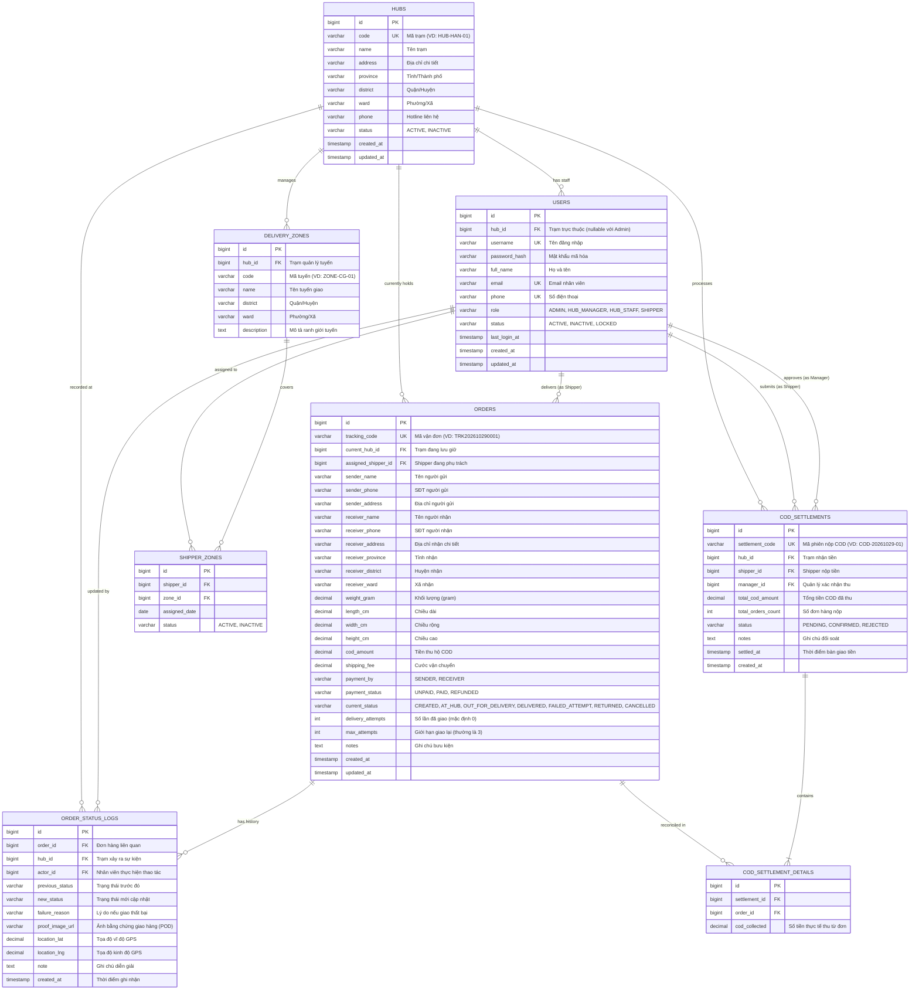

# THIẾT KẾ CƠ SỞ DỮ LIỆU (DATABASE DESIGN)
## Hệ Thống Quản Lý Trạm Giao Nhận (Delivery Hub Management System)
**Môn học:** IT3180 - Công nghệ phần mềm  
**Hệ quản trị CSDL đề xuất:** PostgreSQL / MySQL 8.0+  
**Phiên bản:** 1.0  
**Ngày cập nhật:** 29/10/2026  

---

## 1. Sơ đồ Quan hệ Thực thể (Entity-Relationship Diagram - ERD)



---

## 2. Từ điển Dữ liệu Chi tiết (Data Dictionary)

### 2.1 Bảng `hubs` (Trạm giao nhận / Bưu cục)
Lưu trữ thông tin các nút trạm trong mạng lưới logistics.

| Tên trường | Kiểu dữ liệu | Ràng buộc | Mô tả ý nghĩa |
|:---|:---|:---|:---|
| `id` | BIGINT | PRIMARY KEY, AUTO_INCREMENT | Khóa chính |
| `code` | VARCHAR(50) | NOT NULL, UNIQUE | Mã trạm duy nhất (VD: `HUB-HN-BD`) |
| `name` | VARCHAR(150) | NOT NULL | Tên trạm giao nhận |
| `address` | VARCHAR(255) | NOT NULL | Địa chỉ chi tiết số nhà, tên đường |
| `province` | VARCHAR(100) | NOT NULL | Tỉnh / Thành phố |
| `district` | VARCHAR(100) | NOT NULL | Quận / Huyện / Thị xã |
| `ward` | VARCHAR(100) | NULL | Phường / Xã |
| `phone` | VARCHAR(20) | NULL | Số điện thoại liên hệ của trạm |
| `status` | VARCHAR(20) | NOT NULL, DEFAULT 'ACTIVE' | `ACTIVE` (Hoạt động), `INACTIVE` (Tạm dừng) |
| `created_at` | TIMESTAMP | DEFAULT CURRENT_TIMESTAMP | Thời gian tạo |
| `updated_at` | TIMESTAMP | DEFAULT CURRENT_TIMESTAMP | Thời gian cập nhật gần nhất |

---

### 2.2 Bảng `users` (Tài khoản & Nhân viên)
Lưu trữ toàn bộ nhân sự vận hành hệ thống (Admin, Quản lý, Điều phối kho, Shipper).

| Tên trường | Kiểu dữ liệu | Ràng buộc | Mô tả ý nghĩa |
|:---|:---|:---|:---|
| `id` | BIGINT | PRIMARY KEY, AUTO_INCREMENT | Khóa chính |
| `hub_id` | BIGINT | NULL, FK -> `hubs(id)` | Trạm trực thuộc (NULL đối với Super Admin) |
| `username` | VARCHAR(50) | NOT NULL, UNIQUE | Tên đăng nhập |
| `password_hash` | VARCHAR(255) | NOT NULL | Mật khẩu băm (Bcrypt / Argon2) |
| `full_name` | VARCHAR(100) | NOT NULL | Họ và tên nhân viên |
| `email` | VARCHAR(100) | NOT NULL, UNIQUE | Email liên lạc |
| `phone` | VARCHAR(20) | NOT NULL, UNIQUE | Số điện thoại di động |
| `role` | VARCHAR(30) | NOT NULL | `ADMIN`, `HUB_MANAGER`, `HUB_STAFF`, `SHIPPER` |
| `status` | VARCHAR(20) | NOT NULL, DEFAULT 'ACTIVE' | `ACTIVE`, `INACTIVE`, `LOCKED` |
| `last_login_at` | TIMESTAMP | NULL | Thời điểm đăng nhập gần nhất |
| `created_at` | TIMESTAMP | DEFAULT CURRENT_TIMESTAMP | Thời điểm tạo hồ sơ |
| `updated_at` | TIMESTAMP | DEFAULT CURRENT_TIMESTAMP | Thời điểm cập nhật |

---

### 2.3 Bảng `delivery_zones` & `shipper_zones` (Phân chia Tuyến giao)
Hỗ trợ quản lý và tự động hóa chia tuyến cho nhân viên giao hàng.

* **Bảng `delivery_zones`:**
  * `id`: BIGINT (PK)
  * `hub_id`: BIGINT (FK -> `hubs.id`)
  * `code`: VARCHAR(50) (Mã tuyến, ví dụ `ZN-CG-01`)
  * `name`: VARCHAR(100) (Tên tuyến, ví dụ `Tuyến Dịch Vọng Hậu`)
  * `district`: VARCHAR(100)
  * `ward`: VARCHAR(100)
  * `description`: TEXT

* **Bảng `shipper_zones`:**
  * `id`: BIGINT (PK)
  * `shipper_id`: BIGINT (FK -> `users.id`)
  * `zone_id`: BIGINT (FK -> `delivery_zones.id`)
  * `assigned_date`: DATE (Ngày bắt đầu phân công)
  * `status`: VARCHAR(20) DEFAULT 'ACTIVE'

---

### 2.4 Bảng `orders` (Quản lý Đơn hàng)
Thực thể hạt nhân của hệ thống giao nhận.

| Tên trường | Kiểu dữ liệu | Ràng buộc | Mô tả ý nghĩa |
|:---|:---|:---|:---|
| `id` | BIGINT | PRIMARY KEY, AUTO_INCREMENT | Khóa chính |
| `tracking_code` | VARCHAR(50) | NOT NULL, UNIQUE | Mã vận đơn duy nhất tra cứu công khai |
| `current_hub_id` | BIGINT | NULL, FK -> `hubs(id)` | Trạm hiện tại đang lưu giữ gói hàng |
| `assigned_shipper_id` | BIGINT | NULL, FK -> `users(id)` | Shipper đang nhận nhiệm vụ giao |
| `sender_name` | VARCHAR(100) | NOT NULL | Tên người gửi |
| `sender_phone` | VARCHAR(20) | NOT NULL | Số điện thoại người gửi |
| `sender_address` | VARCHAR(255) | NOT NULL | Địa chỉ người gửi |
| `receiver_name` | VARCHAR(100) | NOT NULL | Tên người nhận |
| `receiver_phone` | VARCHAR(20) | NOT NULL | Số điện thoại người nhận |
| `receiver_address` | VARCHAR(255) | NOT NULL | Số nhà, ngõ, tên đường người nhận |
| `receiver_province` | VARCHAR(100) | NOT NULL | Tỉnh / Thành nhận hàng |
| `receiver_district` | VARCHAR(100) | NOT NULL | Quận / Huyện nhận hàng |
| `receiver_ward` | VARCHAR(100) | NULL | Phường / Xã nhận hàng |
| `weight_gram` | DECIMAL(10,2)| NOT NULL | Trọng lượng (đơn vị: gram) |
| `length_cm` | DECIMAL(8,2) | DEFAULT 0 | Chiều dài gói hàng |
| `width_cm` | DECIMAL(8,2) | DEFAULT 0 | Chiều rộng gói hàng |
| `height_cm` | DECIMAL(8,2) | DEFAULT 0 | Chiều cao gói hàng |
| `cod_amount` | DECIMAL(12,2)| NOT NULL, DEFAULT 0 | Tiền thu hộ COD (VNĐ) |
| `shipping_fee` | DECIMAL(12,2)| NOT NULL, DEFAULT 0 | Cước phí dịch vụ vận chuyển |
| `payment_by` | VARCHAR(20) | NOT NULL, DEFAULT 'SENDER' | `SENDER` (Người gửi trả), `RECEIVER` (Người nhận trả) |
| `payment_status` | VARCHAR(20) | NOT NULL, DEFAULT 'UNPAID' | `UNPAID` (Chưa thanh toán), `PAID` (Đã thanh toán) |
| `current_status` | VARCHAR(30) | NOT NULL, DEFAULT 'CREATED' | Xem danh mục trạng thái mục 3 |
| `delivery_attempts` | INT | NOT NULL, DEFAULT 0 | Số lần shipper đã đi giao nhưng thất bại |
| `max_attempts` | INT | NOT NULL, DEFAULT 3 | Số lần tối đa trước khi tự động chuyển hoàn |
| `notes` | TEXT | NULL | Ghi chú từ người gửi/nhân viên |
| `created_at` | TIMESTAMP | DEFAULT CURRENT_TIMESTAMP | Thời điểm tạo đơn |
| `updated_at` | TIMESTAMP | DEFAULT CURRENT_TIMESTAMP | Thời điểm cập nhật cuối cùng |

---

### 2.5 Bảng `order_status_logs` (Hành trình Vận chuyển & Kiểm vết)
Ghi nhận bất biến (Append-only) mỗi khi trạng thái đơn hàng thay đổi.

| Tên trường | Kiểu dữ liệu | Ràng buộc | Mô tả ý nghĩa |
|:---|:---|:---|:---|
| `id` | BIGINT | PRIMARY KEY, AUTO_INCREMENT | Khóa chính |
| `order_id` | BIGINT | NOT NULL, FK -> `orders(id)` | Khóa ngoại tới đơn hàng |
| `hub_id` | BIGINT | NULL, FK -> `hubs(id)` | Trạm xảy ra sự kiện cập nhật |
| `actor_id` | BIGINT | NOT NULL, FK -> `users(id)` | Ai là người thực hiện cập nhật |
| `previous_status` | VARCHAR(30) | NULL | Trạng thái trước khi đổi |
| `new_status` | VARCHAR(30) | NOT NULL | Trạng thái mới áp dụng |
| `failure_reason` | VARCHAR(255) | NULL | Lý do nếu chuyển sang FAILED_ATTEMPT |
| `proof_image_url` | VARCHAR(500) | NULL | Link ảnh bằng chứng giao hàng (POD) |
| `location_lat` | DECIMAL(10,7)| NULL | Vĩ độ GPS lúc shipper cập nhật |
| `location_lng` | DECIMAL(10,7)| NULL | Kinh độ GPS lúc shipper cập nhật |
| `note` | TEXT | NULL | Ghi chú thêm (VD: Gửi lễ tân tầng 1) |
| `created_at` | TIMESTAMP | DEFAULT CURRENT_TIMESTAMP | Thời điểm sự kiện diễn ra |

---

### 2.6 Bảng `cod_settlements` & `cod_settlement_details` (Đối soát Thu hộ)
Theo dõi dòng tiền thu hộ giữa Shipper và Quản lý trạm vào cuối ca làm việc.

* **Bảng `cod_settlements`:**
  * `id`: BIGINT (PK)
  * `settlement_code`: VARCHAR(50) (UNIQUE)
  * `hub_id`: BIGINT (FK -> `hubs.id`)
  * `shipper_id`: BIGINT (FK -> `users.id`)
  * `manager_id`: BIGINT (FK -> `users.id` - người duyệt)
  * `total_cod_amount`: DECIMAL(14,2) (Tổng tiền thực nộp)
  * `total_orders_count`: INT (Số lượng đơn thành công đã thu tiền)
  * `status`: VARCHAR(20) (`PENDING`, `CONFIRMED`, `REJECTED`)
  * `notes`: TEXT
  * `settled_at`: TIMESTAMP
  * `created_at`: TIMESTAMP

* **Bảng `cod_settlement_details`:**
  * `id`: BIGINT (PK)
  * `settlement_id`: BIGINT (FK -> `cod_settlements.id`)
  * `order_id`: BIGINT (FK -> `orders.id`)
  * `cod_collected`: DECIMAL(12,2)

---

## 3. Định nghĩa Vòng đời Trạng thái Đơn hàng (`current_status`)

```text
  [CREATED]
      │ (Khách gửi tại trạm / Tạo trên hệ thống)
      ▼
   [AT_HUB]  ◄───────────────────────────┐
      │ (Quét mã nhập trạm)              │
      ▼                                  │
[OUT_FOR_DELIVERY]                       │ (Hẹn giao lại - lần < 3)
      │ (Gán cho Shipper đi giao)        │
      ├────────────────────────┬─────────┘
      │ (Giao thành công)      │ (Giao thất bại)
      ▼                        ▼
 [DELIVERED]            [FAILED_ATTEMPT]
 (Hoàn tất)                    │
                               │ (Thất bại lần 3 hoặc Khách từ chối nhận)
                               ▼
                       [RETURN_PENDING]
                               │
                               ▼
                           [RETURNED] (Hoàn trả về người gửi)
```

Các giá trị Enum của `current_status`:
1. `CREATED`: Đơn vừa được tạo, chưa nhập kho/trạm.
2. `AT_HUB`: Đơn đã đến trạm giao nhận và được quét mã nhập kho.
3. `OUT_FOR_DELIVERY`: Đã giao cho Shipper mang đi phát cho người nhận.
4. `DELIVERED`: Giao thành công (đã có ảnh POD và thu đủ COD nếu có).
5. `FAILED_ATTEMPT`: Giao không thành công lần 1 hoặc 2 (chờ phát lại).
6. `RETURN_PENDING`: Quá số lần giao hoặc khách từ chối, chờ chuyển hoàn.
7. `RETURNED`: Đã hoàn trả bưu kiện thành công về người gửi.
8. `CANCELLED`: Đơn bị hủy trước khi giao hàng.

---

## 4. Thiết kế Chỉ mục (Indexes) Tối ưu Truy vấn

Nhằm đảm bảo tốc độ phản hồi nhanh khi cơ sở dữ liệu phình to lên hàng trăm ngàn đơn:

1. **`orders`**:
   * `idx_orders_tracking_code` (B-Tree trên `tracking_code`): Phục vụ tra cứu công khai và quét mã vạch cực nhanh ($O(1)$ / $O(\log N)$).
   * `idx_orders_status_hub` (Composite index `current_hub_id`, `current_status`): Tối ưu lọc danh sách đơn đang chờ điều phối tại trạm.
   * `idx_orders_shipper_status` (Composite index `assigned_shipper_id`, `current_status`): Tối ưu cho màn hình app của Shipper.
   * `idx_orders_receiver_phone` (B-Tree trên `receiver_phone`): Tra cứu theo số điện thoại khách hàng.

2. **`order_status_logs`**:
   * `idx_logs_order_id` (`order_id`, `created_at` DESC): Tối ưu hiển thị Timeline hành trình đơn hàng.

3. **`users`**:
   * `idx_users_hub_role` (`hub_id`, `role`): Lọc danh sách nhân viên/shipper theo từng trạm.

---

## 5. Ước lượng Kích thước & Chi phí Lưu trữ CSDL (Storage Cost Estimation)

Để tối ưu hóa chi phí vận hành hạ tầng và chuẩn bị tốt cho báo cáo môn Công nghệ phần mềm (IT3180), nhóm đã tính toán dung lượng đĩa cứng (Disk Footprint) trên hệ quản trị **PostgreSQL**:

### 5.1 Kích thước Trung bình Một Bản ghi (Row Size Estimation)
1. **Bảng `orders`:**
   * Thông tin số & định danh (`id`, `tracking_code`, `current_hub_id`, `assigned_shipper_id`, `cod_amount`, `shipping_fee`, kích thước `L-W-H`, `weight`): ~120 Bytes.
   * Thông tin địa chỉ người gửi và người nhận (Họ tên, SĐT, số nhà, phường/xã, quận/huyện, tỉnh/thành): ~280 Bytes.
   * Trạng thái, số lần giao, ghi chú, timestamps và Postgres row header (24 Bytes): ~100 Bytes.
   * $\Rightarrow$ **Trung bình:** $\approx 500\text{ Bytes / đơn hàng}$.

2. **Bảng `order_status_logs` (Hành trình kiểm vết):**
   * Trong vòng đời vận chuyển, một bưu kiện trung bình trải qua 3 mốc sự kiện (`CREATED` $\rightarrow$ `AT_HUB` $\rightarrow$ `DELIVERED`).
   * Mỗi bản ghi log (`id`, `order_id`, `actor_id`, `previous_status`, `new_status`, `failure_reason`, URL ảnh POD, tọa độ GPS, ghi chú, header): $\approx 300\text{ Bytes}$.
   * $\Rightarrow$ **Trung bình:** $3 \times 300\text{ Bytes} \approx 900\text{ Bytes / đơn hàng hoàn tất}$.

3. **Bảng phụ trợ (`hubs`, `users`, `delivery_zones`, `cod_settlements`):** $\approx 150\text{ Bytes / đơn hàng}$.
* $\Rightarrow$ **Tổng dung lượng dữ liệu thô (Table Data):** $\approx 1.55\text{ KB / đơn hàng hoàn tất}$.

### 5.2 Kích thước Chỉ mục B-Tree (Index Overhead)
Hệ thống thiết lập 12 Indexes để tối ưu hóa truy vấn cho toàn bộ 23 Use Cases:
* B-Tree index trên `orders` (PK, `tracking_code`, `receiver_phone`, `sender_phone`, `[current_hub_id, current_status]`, `[assigned_shipper_id, current_status]`, `[current_hub_id, receiver_district, receiver_ward]`, `createdAt`): $\approx 320\text{ Bytes / đơn}$.
* B-Tree index trên `order_status_logs` (PK, `[order_id, created_at DESC]`): $\approx 210\text{ Bytes / đơn}$.
* $\Rightarrow$ **Tổng dung lượng chỉ mục (Index Size):** $\approx 530\text{ Bytes / đơn hàng}$ (chiếm khoảng 34% dung lượng dữ liệu thô).

### 5.3 Bảng Tổng hợp Dung lượng & Dự toán Chi phí Cloud theo Quy mô

| Quy mô Đơn hàng | Dung lượng Dữ liệu (Tables) | Dung lượng Chỉ mục (Indexes) | Tổng Dung lượng CSDL | Dung lượng Ảnh POD (Cloudflare R2) | Dự toán Chi phí Vận hành Cloud / Tháng |
|:---:|:---:|:---:|:---:|:---:|:---|
| **10.000 đơn** *(Mức Demo / Đồ án môn học)* | 15.5 MB | 5.3 MB | **~20.8 MB** | ~2.0 GB *(200KB/ảnh)* | **0 VNĐ / tháng** *(Nằm hoàn toàn trong hạn mức Free Tier của Supabase 500MB & Cloudflare R2 10GB)* |
| **100.000 đơn** *(1 Trạm quy mô lớn / tháng)* | 155 MB | 53 MB | **~208 MB** | ~20 GB | **~3.800 VNĐ / tháng** *(CSDL vẫn nằm trong gói Free 500MB; R2 vượt 10GB tính 0.015$/GB)* |
| **1.000.000 đơn** *(Toàn mạng lưới / năm)* | 1.55 GB | 530 MB | **~2.08 GB** | ~200 GB | **~120.000 - 350.000 VNĐ / tháng** *(Gói Supabase Pro 25$ hoặc VPS PostgreSQL 2 Cores 4GB RAM + R2)* |

