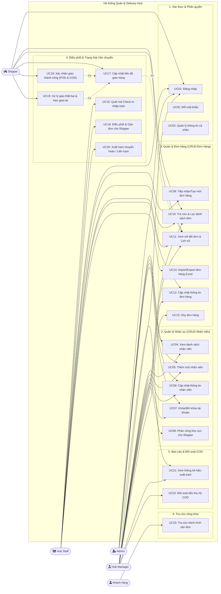

# ĐẶC TẢ USE CASE VÀ SƠ ĐỒ CHỨC NĂNG
## Hệ Thống Quản Lý Trạm Giao Nhận (Delivery Hub Management System)
**Môn học:** IT3180 - Công nghệ phần mềm  
**Phiên bản:** 1.0  
**Ngày cập nhật:** 29/10/2026  

---

## 1. Danh sách Tác nhân (Actors)

| STT | Tác nhân (Actor) | Mô tả vai trò |
|:---:|:---|:---|
| 1 | **Admin (Quản trị viên hệ thống)** | Toàn quyền quản trị hệ thống, quản lý danh sách trạm (Hub), cấu hình tham số hệ thống, tạo tài khoản quản lý và kiểm tra log toàn cục. |
| 2 | **Hub Manager (Quản lý trạm)** | Phụ trách một trạm giao nhận cụ thể: quản lý nhân sự tại trạm (Hub Staff, Shipper), giám sát luồng hàng hóa, giải quyết sự cố, xem báo cáo KPI và đối soát tiền COD. |
| 3 | **Hub Staff / Dispatcher (Nhân viên điều phối / Kho)** | Tiếp nhận hàng nhập trạm (Inbound scan), phân loại hàng theo khu vực, điều phối gán đơn cho Shipper, xử lý đơn chuyển tiếp liên trạm hoặc chuyển hoàn (Return). |
| 4 | **Shipper (Nhân viên giao hàng)** | Nhận danh sách đơn được phân công, lấy hàng ra khỏi kho, đi giao, cập nhật trạng thái vận chuyển kèm bằng chứng (ảnh POD) và thu tiền COD. |
| 5 | **Customer / Guest (Khách hàng)** | Người gửi hoặc người nhận thực hiện tra cứu hành trình đơn hàng công khai qua mã vận đơn (Tracking number). |

---

## 2. Sơ đồ Use Case Tổng thể (Use Case Diagram)

---

## 3. Ma trận Phân quyền Chức năng (RBAC Matrix)

| Mã Use Case | Tên Chức năng | Admin | Hub Manager | Hub Staff | Shipper | Khách vãng lai |
|:---:|:---|:---:|:---:|:---:|:---:|:---:|
| **UC01 - UC03** | Đăng nhập / Đổi mật khẩu / Cá nhân | ✔ | ✔ | ✔ | ✔ | ✖ |
| **UC04 - UC07** | CRUD Nhân viên & Tài khoản | ✔ | ✔ (Trong trạm) | ✖ | ✖ | ✖ |
| **UC08** | Phân tuyến giao hàng cho Shipper | ✔ | ✔ | ✖ | ✖ | ✖ |
| **UC09** | Tạo mới đơn hàng tại trạm | ✔ | ✔ | ✔ | ✖ | ✖ |
| **UC10 - UC11** | Tìm kiếm / Xem chi tiết đơn hàng | ✔ | ✔ | ✔ | ✔ (Đơn được gán) | ✖ |
| **UC12 - UC13** | Cập nhật / Hủy đơn hàng | ✔ | ✔ | ✔ | ✖ | ✖ |
| **UC14** | Import/Export đơn hàng Excel | ✔ | ✔ | ✔ | ✖ | ✖ |
| **UC15** | Quét Check-in nhập trạm (Inbound) | ✔ | ✔ | ✔ | ✖ | ✖ |
| **UC16** | Gán đơn hàng cho Shipper | ✔ | ✔ | ✔ | ✖ | ✖ |
| **UC17 - UC19** | Cập nhật trạng thái giao (Thành công/Lỗi) | ✖ | ✖ | ✖ | ✔ | ✖ |
| **UC20** | Xuất trạm / Chuyển hoàn (Outbound) | ✔ | ✔ | ✔ | ✖ | ✖ |
| **UC21 - UC22** | Báo cáo KPI & Đối soát COD | ✔ | ✔ | ✖ | ✖ | ✖ |
| **UC23** | Tra cứu công khai hành trình vận đơn | ✔ | ✔ | ✔ | ✔ | ✔ |

---

## 4. Đặc tả Chi tiết các Use Case Trọng tâm

### UC01: Đăng nhập Hệ thống
* **Tác nhân:** Toàn bộ người dùng nội bộ (Admin, Hub Manager, Hub Staff, Shipper).
* **Mục tiêu:** Xác thực danh tính và phân quyền truy cập chức năng phù hợp.
* **Tiền điều kiện:** Người dùng đã được cấp tài khoản hoạt động trong hệ thống.
* **Hậu điều kiện:** Người dùng được cấp JWT Token / Phiên làm việc và chuyển đến Dashboard theo vai trò.
* **Luồng sự kiện chính (Basic Flow):**
  1. Người dùng truy cập trang Đăng nhập và điền: Tên đăng nhập/Email, Mật khẩu.
  2. Người dùng nhấn nút "Đăng nhập".
  3. Hệ thống kiểm tra tài khoản, mã hóa và so khớp mật khẩu (bcrypt).
  4. Hệ thống kiểm tra trạng thái tài khoản: đang hoạt động (Active).
  5. Hệ thống khởi tạo Token/Session, ghi nhận thời gian đăng nhập gần nhất.
  6. Hệ thống chuyển hướng người dùng đến giao diện tương ứng với vai trò (Role).
* **Luồng rẽ nhánh / Ngoại lệ (Alternative & Exception Flows):**
  * *3a. Sai thông tin đăng nhập:* Hệ thống hiển thị thông báo "Tên đăng nhập hoặc mật khẩu không chính xác".
  * *4a. Tài khoản bị vô hiệu hóa (Banned/Inactive):* Hệ thống thông báo "Tài khoản của bạn đã bị khóa. Vui lòng liên hệ quản lý trạm".
  * *5a. Đăng nhập sai quá 5 lần liên tiếp:* Khóa tạm thời 15 phút để bảo vệ tài khoản khỏi tấn công Brute-force.

---

### UC05 & UC06: Thêm mới và Cập nhật Nhân viên (CRUD Nhân viên)
* **Tác nhân:** Admin, Hub Manager.
* **Mục tiêu:** Tạo mới hồ sơ nhân sự, cấp tài khoản và chỉ định trạm làm việc, phân quyền chức vụ.
* **Tiền điều kiện:** Người dùng đã đăng nhập với vai trò Admin hoặc Hub Manager.
* **Hậu điều kiện:** Bản ghi nhân viên mới được lưu vào CSDL; tài khoản sẵn sàng sử dụng.
* **Luồng sự kiện chính (Thêm mới):**
  1. Quản lý truy cập mục "Quản lý nhân viên" và nhấn "Thêm mới nhân viên".
  2. Giao diện hiển thị biểu mẫu bao gồm:
     * Họ và tên, Email, Số điện thoại, CCCD.
     * Vai trò: Hub Manager, Hub Staff, hoặc Shipper.
     * Trạm làm việc (Hub): Admin có thể chọn trạm bất kỳ, Manager mặc định gắn với trạm của mình.
     * Tên đăng nhập và Mật khẩu khởi tạo.
  3. Quản lý điền đầy đủ thông tin hợp lệ và nhấn "Lưu".
  4. Hệ thống kiểm tra ràng buộc: Email, Số điện thoại, Tên đăng nhập không được trùng lặp.
  5. Hệ thống mã hóa mật khẩu, lưu thông tin vào bảng `users`, gửi thông báo tạo thành công.
  6. Danh sách nhân viên được cập nhật hiển thị nhân viên mới.
* **Luồng rẽ nhánh / Ngoại lệ:**
  * *4a. Trùng lặp thông tin (Email/Phone/Username):* Hệ thống đánh dấu trường bị trùng và hiển thị thông báo lỗi.
  * *4b. Thiếu trường bắt buộc:* Hệ thống hiển thị lỗi validation dưới từng input.

---

### UC09: Tiếp nhận / Tạo mới Đơn hàng (CRUD Đơn hàng)
* **Tác nhân:** Hub Staff, Hub Manager, Admin.
* **Mục tiêu:** Tiếp nhận gói hàng từ khách gửi trực tiếp tại trạm hoặc tạo đơn hàng mới vào hệ thống.
* **Tiền điều kiện:** Nhân viên đã đăng nhập hệ thống.
* **Hậu điều kiện:** Đơn hàng được tạo thành công với mã vận đơn duy nhất (`tracking_code`), trạng thái ban đầu là `CREATED` hoặc `AT_HUB`.
* **Luồng sự kiện chính:**
  1. Nhân viên nhấn nút "Tạo đơn hàng mới".
  2. Nhân viên nhập thông tin đơn hàng:
     * Người gửi: Họ tên, Số điện thoại, Địa chỉ chi tiết (Tỉnh/Huyện/Xã/Số nhà).
     * Người nhận: Họ tên, Số điện thoại, Địa chỉ nhận hàng.
     * Thông tin bưu kiện: Loại hàng, Trọng lượng (gram), Kích thước (Dài x Rộng x Cao cm), Giá trị khai giá.
     * Cước phí & Tiền thu hộ: Cước vận chuyển, Tiền COD (mặc định 0đ), Ai trả cước (Người gửi / Người nhận).
     * Ghi chú đơn hàng (ví dụ: "Cho xem hàng, không cho thử").
  3. Nhân viên nhấn "Xác nhận tạo đơn".
  4. Hệ thống kiểm tra tính hợp lệ của dữ liệu (SĐT 10 số, trọng lượng > 0...).
  5. Hệ thống tự động sinh mã vận đơn duy nhất dạng quy chuẩn (VD: `HUB-20261029-XXXX`).
  6. Hệ thống lưu bản ghi vào bảng `orders`, đồng thời tạo một bản ghi lịch sử trạng thái đầu tiên trong `order_status_logs`.
  7. Hệ thống hiển thị popup thành công kèm tùy chọn: "In phiếu gửi / Mã Barcode".
* **Luồng rẽ nhánh / Ngoại lệ:**
  * *4a. Số điện thoại sai định dạng:* Báo lỗi trường số điện thoại.
  * *4b. Lỗi kết nối CSDL:* Thông báo thử lại sau ít phút.

---

### UC15: Quét mã Check-in Nhập trạm (Inbound Scan)
* **Tác nhân:** Hub Staff.
* **Mục tiêu:** Ghi nhận các đơn hàng vật lý đã về đến trạm lưu kho, chuẩn bị chia chọn.
* **Tiền điều kiện:** Nhân viên đã đăng nhập và mở giao diện "Nhập kho / Quét mã Inbound".
* **Hậu điều kiện:** Trạng thái đơn đổi thành `AT_HUB`, vị trí hiện tại trỏ về trạm này.
* **Luồng sự kiện chính:**
  1. Nhân viên sử dụng máy quét mã vạch (Barcode Scanner) hoặc camera/nhập tay mã vận đơn.
  2. Hệ thống nhận diện mã và tìm kiếm đơn hàng trong CSDL.
  3. Hệ thống kiểm tra trạng thái hiện tại của đơn hàng.
  4. Hệ thống cập nhật:
     * Trạng thái đơn: `AT_HUB` (Đã đến trạm).
     * `current_hub_id` = ID trạm hiện tại.
     * Tạo bản ghi log `order_status_logs` (Ghi rõ thời gian, nhân viên quét, vị trí).
  5. Hệ thống phát âm thanh "Bíp" thành công và hiển thị đơn hàng vừa quét vào danh sách bưu kiện nhập kho trong ca.
* **Luồng rẽ nhánh / Ngoại lệ:**
  * *2a. Mã vận đơn không tồn tại:* Hệ thống phát âm cảnh báo và báo lỗi "Không tìm thấy mã vận đơn trên hệ thống".
  * *3a. Đơn đã ở trạng thái kết thúc (Đã giao / Đã hủy):* Hệ thống hiển thị cảnh báo bất thường "Đơn hàng này đã hoàn tất hoặc bị hủy".

---

### UC16: Điều phối & Gán Đơn hàng cho Shipper
* **Tác nhân:** Hub Staff, Hub Manager.
* **Mục tiêu:** Phân chia các đơn đang lưu tại trạm cho các Shipper phù hợp để bắt đầu giao hàng.
* **Tiền điều kiện:** Các đơn hàng đang ở trạng thái `AT_HUB` thuộc địa bàn giao của trạm; Shipper đang có trạng thái hoạt động.
* **Hậu điều kiện:** Đơn hàng được liên kết với `assigned_shipper_id`, chuyển trạng thái sang `ASSIGNED` hoặc `OUT_FOR_DELIVERY`.
* **Luồng sự kiện chính:**
  1. Nhân viên chọn tab "Điều phối giao hàng".
  2. Hệ thống hiển thị danh sách các đơn đang chờ giao tại trạm, nhóm theo tuyến/khu vực (Quận/Huyện/Xã).
  3. Nhân viên tích chọn một hoặc nhiều đơn hàng cần gán.
  4. Nhân viên chọn Shipper từ danh sách các Shipper khả dụng của trạm.
  5. Nhân viên nhấn nút "Xác nhận gán đơn".
  6. Hệ thống cập nhật:
     * Gán `assigned_shipper_id` cho các đơn đã chọn.
     * Chuyển trạng thái đơn sang `OUT_FOR_DELIVERY` (Đang giao hàng).
     * Tạo bản ghi `order_status_logs` cho từng đơn với ghi chú "Đã bàn giao cho Shipper [Tên/SĐT]".
  7. Hệ thống cập nhật danh sách hiển thị và gửi thông báo/hiển thị đơn mới trên màn hình của Shipper.
* **Luồng rẽ nhánh:**
  * *4a. Shipper đã nhận vượt quá giới hạn đơn tối đa trong ca:* Hệ thống hiển thị cảnh báo quá tải để người điều phối cân nhắc.

---

### UC17 & UC18: Cập nhật Trạng thái Giao hàng (Shipper - POD & COD)
* **Tác nhân:** Shipper.
* **Mục tiêu:** Ghi nhận kết quả giao bưu kiện đến tay người nhận (Thành công hoặc Thất bại).
* **Tiền điều kiện:** Shipper đã đăng nhập và đơn hàng đang trong danh sách `OUT_FOR_DELIVERY` của mình.
* **Hậu điều kiện:** Trạng thái đơn được cập nhật thành `DELIVERED` hoặc `FAILED_ATTEMPT`, lưu bằng chứng giao nhận.
* **Luồng sự kiện chính (Trường hợp GIAO THÀNH CÔNG):**
  1. Shipper mở chi tiết đơn hàng cần giao trên ứng dụng di động/web mobile.
  2. Shipper nhấn nút "Xác nhận giao thành công".
  3. Màn hình yêu cầu cập nhật thông tin:
     * Chụp ảnh bưu kiện đã bàn giao / chữ ký người nhận (Proof of Delivery - POD).
     * Xác nhận số tiền COD đã thu (nếu đơn có COD).
     * Ghi chú (nếu có: ví dụ "Gửi bảo vệ tòa nhà").
  4. Shipper nhấn "Hoàn tất giao hàng".
  5. Hệ thống tải ảnh POD lên bộ lưu trữ, cập nhật đơn hàng:
     * Trạng thái đơn = `DELIVERED`.
     * `payment_status` = `PAID` (nếu có COD).
     * Lưu log vào `order_status_logs` kèm link ảnh và tọa độ GPS (nếu có).
  6. Hệ thống hiển thị thông báo thành công và trừ đơn này khỏi danh sách cần giao trong ca.

* **Luồng rẽ nhánh (Trường hợp GIAO THẤT BẠI - UC19):**
  * *2a. Khách không nhận hoặc không liên lạc được:*
    1. Shipper chọn "Báo giao thất bại".
    2. Shipper chọn lý do từ danh mục có sẵn:
       * Không liên lạc được với người nhận (gọi quá 3 cuộc).
       * Khách hàng hẹn giao lại ngày khác.
       * Sai địa chỉ / Sai thông tin người nhận.
       * Khách hàng từ chối nhận (Không đúng hàng, không có tiền...).
    3. Shipper chụp ảnh nhật ký cuộc gọi hoặc vị trí giao hàng làm bằng chứng xác thực.
    4. Shipper chọn ngày hẹn giao lại (nếu khách hẹn).
    5. Hệ thống tăng bộ đếm số lần giao thất bại (`delivery_attempts += 1`).
    6. Nếu `delivery_attempts < 3`: Chuyển trạng thái sang `FAILED_ATTEMPT`, đưa về kho chờ giao lại.
    7. Nếu `delivery_attempts >= 3` hoặc Khách từ chối nhận vĩnh viễn: Đơn được đề xuất chuyển sang trạng thái `RETURN_PENDING` (Chờ hoàn về người gửi).

---

### UC23: Tra cứu Hành trình Vận đơn (Public Tracking)
* **Tác nhân:** Khách hàng (Bất kỳ ai có mã vận đơn).
* **Mục tiêu:** Tra cứu tiến độ đơn hàng và thời gian các mốc di chuyển mà không cần tài khoản đăng nhập.
* **Tiền điều kiện:** Có mã vận đơn hợp lệ.
* **Hậu điều kiện:** Hiển thị trang Timeline trực quan về quá trình giao nhận của bưu kiện.
* **Luồng sự kiện chính:**
  1. Người dùng truy cập trang chủ / mục Tra cứu vận đơn.
  2. Người dùng nhập mã vận đơn vào ô tìm kiếm và bấm "Tra cứu".
  3. Hệ thống tìm kiếm bản ghi đơn hàng và truy vấn danh sách log tương ứng trong `order_status_logs` sắp xếp theo thời gian mới nhất.
  4. Hệ thống render giao diện Timeline:
     * Thông tin tóm tắt: Tên gói hàng, trạng thái hiện tại (Đang vận chuyển, Đã giao...), trạm hiện tại.
     * Dòng thời gian chi tiết: Giờ, ngày, sự kiện (Tạo đơn -> Nhập trạm -> Đang giao -> Giao thành công).
     * *(Lưu ý bảo mật: Ẩn bớt 3 số giữa của SĐT người gửi/nhận để tuân thủ bảo vệ dữ liệu cá nhân).*
* **Luồng rẽ nhánh:**
  * *3a. Không tìm thấy mã vận đơn:* Hệ thống thông báo "Mã vận đơn không tồn tại trên hệ thống. Quý khách vui lòng kiểm tra lại".
